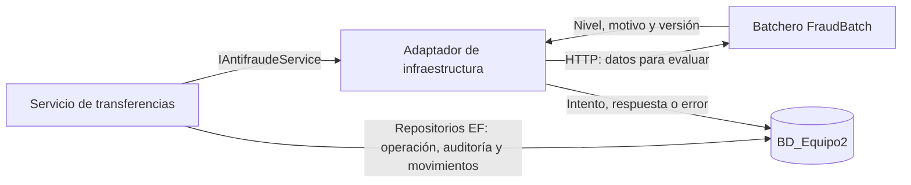

# Servicio de transferencias, batchero y seguimiento SQL

La API puede utilizar el modelo existente de **BD_Equipo2**. El modo predeterminado
sigue siendo `Memory`. Iniciar el servicio o el batch no crea tablas, no aplica
migraciones ni carga datos. Los comentarios de los archivos nuevos están en español.

## Distribución de responsabilidades

| Capa/proyecto | Implementación |
|---|---|
| Domain | Entidades, interfaces, reglas de transferencia y `PoliticaFraude`, pura y versionada. No referencia EF. |
| Application | El handler valida y coordina repositorios, riesgo, OTP, débito, cámara y auditoría mediante interfaces. |
| SqlServerInfrastructure/Persistence | DbContext y once modelos `*Row`, relaciones, índices, columnas calculadas y cuatro rowversion. |
| SqlServerInfrastructure/Repositories | Consultas, límites, auditoría y movimientos financieros dentro de una transacción SQL. |
| SqlServerInfrastructure/Coordination | Bloqueo por GUID entre instancias de API mediante `sp_getapplock`. |
| SqlServerInfrastructure/Adapters | Consulta HTTP al batchero, registro de cada intento/respuesta/error y preparación de notificaciones. |
| SqlServerInfrastructure/Http | Cliente HTTP tipado que valida la referencia, el nivel, el motivo y la versión de respuesta. |
| FraudBatch | Servicio independiente que evalúa el riesgo solicitado por HTTP. En este modo no accede a SQL ni mueve dinero. |
| SystemAPI | Selecciona los adaptadores mediante configuración. Conserva los endpoints y contratos existentes. |

Los modelos EF se convierten a los records del dominio; EF permanece en infraestructura.
El handler tiene duración por solicitud. Los repositorios crean contextos cortos mediante
`IDbContextFactory`, evitando compartir un contexto entre solicitudes simultáneas.

## Configurar y ejecutar

Configura `ConnectionStrings__Transferencias` en cada terminal de la API y del batch,
con la conexión autorizada. No guardes contraseñas en Git. Ejemplo de formato con
autenticación integrada, reemplazando servidor y puerto:

```powershell
$env:ConnectionStrings__Transferencias = 'Server=SERVIDOR,PUERTO;Database=BD_Equipo2;Integrated Security=True;Encrypt=True;TrustServerCertificate=False'
```

El código rechaza otra base o una conexión que adjunte archivos. El usuario necesita
leer/escribir las tablas correspondientes y usar los bloqueos de aplicación; no se
requieren permisos para crear bases. La confianza del certificado debe configurarse
según el servidor del taller; el código no desactiva su validación.

Terminal de API:

```powershell
$env:Infrastructure__Provider = 'SqlServer'
dotnet build SystemApi3.0.slnx -m:1
dotnet run --project SystemAPI --launch-profile http --no-build
```

Otra terminal para el batchero. El modo HTTP no necesita credenciales SQL:

```powershell
.\FraudBatch\ejecutar-fraude.ps1 -Modo Serve
# Equivalente:
dotnet run --project FraudBatch --launch-profile http
```

Para volver al simulador usa `$env:Infrastructure__Provider = 'Memory'` y reinicia la API.
El servicio continúa limitado a `Development`: OTP y cámara todavía son simulados.
JWT y autorización por cliente están implementados; consulta [generación de tokens y permisos](JWT.md).

`Antifraude:BaseUrl` en appsettings apunta a `http://localhost:5210/`. Puede reemplazarse
con `Antifraude__BaseUrl` si el batchero se ejecuta en otra dirección. El endpoint es
`POST /api/fraud/evaluations`; el contrato y ejemplos están en [FraudBatch](../FraudBatch/README.md).

## Flujo integrado



1. `POST /api/transactions` valida la entrada y reserva la referencia durante todo el caso de uso.
2. Consulta cliente, cuenta, banco, saldo y límite; registra una transferencia válida antes de solicitar riesgo.
3. Registra un intento `Procesando` en EvaluacionFraude. Obtiene el historial y consulta al batchero por HTTP.
4. El batchero devuelve nivel, motivo y versión. El servicio registra `Completada` y continúa; una caída,
   respuesta inválida o demora se registra como `Error`, devuelve 503 y no debita. Reintenta el POST con
   el **mismo `transactionReference` y los mismos datos**; cada consulta genera otro intento auditable.
5. Riesgo alto rechaza. Riesgo medio o monto desde S/ 10 000 exige OTP. Para confirmar repite el mismo
   POST y referencia agregando `otpCode`; el valor del taller sigue siendo `123456`.
6. El débito revalida saldo y límite del cliente dentro de una transacción, bloquea las cuentas en orden,
   registra principal/comisión y acredita el destino interno. El envío externo usa el simulador de cámara.
7. Guarda estado y auditoría; prepara SMS y correo por evento. En SQL `customerNotified` permanece
   `false` porque encolar todavía no confirma que alguien recibió el mensaje.

`GET /api/transactions/{transactionReference}` consulta el estado; no reanuda el flujo.
Los nombres especiales `RIESGO_ALTO`, `RIESGO_MEDIO` y `SIN_SERVICIO` pertenecen al
simulador en memoria. En SQL se aplican las reglas del batch.

El acumulado diario usa movimientos reales del cliente, incluso de operaciones
pendientes, y reversos confirmados de los débitos correspondientes a ese día. Se toma
el día efectivo del movimiento en Lima; la fecha de solicitud se conserva para auditoría.
Un resultado financiero incierto queda pendiente de conciliación: no se reenvía ni
devuelve saldo automáticamente. No se habilitan reintentos SQL automáticos de débitos.

Cliente inexistente, cuenta ajena, banco desconocido o misma cuenta se rechazan en el
log sin inventar entidades para satisfacer claves foráneas. Si no llegó a persistirse
una transferencia válida, esa referencia no tendrá registro consultable.

## Reglas ficticias de riesgo TALLER-1.0

| Primera condición que se cumpla | Nivel |
|---|---|
| Monto desde S/ 40 000 o cinco débitos previos desde esa cuenta en quince minutos | Alto |
| Monto desde S/ 10 000 | Medio |
| Destino nuevo desde esa cuenta y monto desde S/ 5 000 | Medio |
| Resto | Bajo |

Alto riesgo no demuestra fraude. La ventana usa el inicio del intento y no cuenta
comisiones ni solicitudes rechazadas. Cada intento consulta nuevamente al batchero;
no se reutiliza una respuesta antigua al confirmar OTP. El cliente HTTP espera hasta
dos segundos y el caso de uso concede cinco para consultar y registrar el riesgo.
Si se cancela, el registro del error dispone de hasta cinco segundos adicionales.
Una caída, error o falta de respuesta nunca equivale a bajo riesgo.

## Verificación y pendientes

```powershell
dotnet run --project Tests/Transferencias.Tests.csproj --no-build
dotnet run --project Tests.Infrastructure/Transferencias.Infrastructure.Tests.csproj --no-build
dotnet run --project FraudBatch --no-build -- --self-test
```

Estas pruebas no abren conexiones: verifican negocio, coordinación en memoria, reglas
de riesgo y mapeo EF contra el DDL guardado. Para comparar también con el servidor:

```powershell
dotnet run --project Tests.Infrastructure -- --sql-read-only
```

La validación de lectura del 23/10/2026 confirmó conexión, esquema (11 tablas,
84 columnas y 16 relaciones) y consultas EF/repositorios en BD_Equipo2 sin modificar
datos. La conexión del taller necesitó aceptar su certificado explícitamente mediante
`TrustServerCertificate=True`, conservando `Encrypt=True`; esto evita validar la cadena
de confianza y corresponde únicamente a esta configuración local. Un certificado
confiable permite volver a `False`.

También se verificó el cliente HTTP con respuestas simuladas y el batchero real con
riesgos bajo/medio/alto y entrada inválida. La opción siguiente prueba el adaptador
HTTP y el registro SQL usando una transacción que siempre revierte sus propias filas:

```powershell
dotnet run --project Tests.Infrastructure -- --sql-http-rollback
```

La prueba confirmó respuesta real guardada, HTTP 503 simulado registrado como Error,
ausencia de movimientos financieros y eliminación de las filas mediante rollback.
Falta validar la transferencia financiera completa y concurrencia entre instancias:
reinicio/reintento, débito atómico y conciliación tras una caída de cámara.

Siguientes pasos: proveedor de identidad real, OTP real con caducidad, cámara real
con idempotencia/conciliación y un trabajador que envíe y confirme notificaciones.
