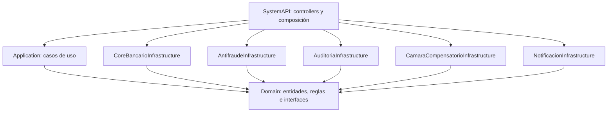

# Taller de transferencias — Clean Architecture

Esta implementación amplía las clases de tu solución SystemApi3.0.slnx en .NET 10.
La guía siguiente describe la demo en memoria, cuyo estado se pierde al reiniciar.
También existe [persistencia SQL con EF y batch de fraude](EF-Y-FRAUDE.md).
El OTP sigue fijo y no se envía dinero ni SMS ni correos reales.

## Ejecutar

Desde la carpeta raíz, con el SDK de .NET 10:

```powershell
dotnet build SystemApi3.0.slnx -m:1
dotnet run --project SystemAPI --launch-profile http --no-build
```

Abre http://localhost:5207/swagger. El perfil http selecciona Development.
El arranque impide ejecutar esta demo en otros entornos porque sus endpoints no
requieren autenticación y sus datos son ficticios.

Para ejecutar las comprobaciones automatizadas:

```powershell
dotnet run --project Tests/Transferencias.Tests.csproj --no-build
```

Tests es un ejecutable de comprobaciones sin framework de pruebas adicional.
Una aserción fallida termina con error; no se ejecuta mediante dotnet test.

## Dependencias entre proyectos

Las flechas indican referencias de código, no llamadas de red.



Domain no tiene dependencias de frameworks ni de otros proyectos. Application solo
referencia Domain; usa las abstracciones de inyección proporcionadas por el framework
compartido de .NET. La API conoce las implementaciones concretas únicamente para
registrarlas en Program.cs. Application nunca instancia un adaptador.

Se mantienen los nombres y carpetas de tus ocho proyectos. Se agregó Tests.
Los nombres históricos de carpetas (AwsSqsInfrastructure, MongodbInfrastructure, etc.)
no significan que esta demo conecte con esos servicios.

Los ejemplos antiguos permanecen en disco. Los csproj excluyen de compilación las
colas de eventos sin sus entidades, ExampleCase sin su interfaz y los adaptadores
antiguos de infraestructura; estos últimos proyectos compilan solo Simulacion.
EventListener, KafkaInfrastructure y SqlServerInfrastructure no forman parte del slnx.
El inicio antiguo de autenticación/listeners se sustituyó por composición local
de la demo. Los handlers originales siguen disponibles para una integración posterior.

## Cómo leer el código

1. SystemAPI/Controllers/TransferenciasController.cs recibe JSON y traduce el
   resultado a HTTP. No calcula comisiones ni límites.
2. Application/Ports/IRealizarTransferencia.cs define la entrada del caso de uso.
3. Application/Handlers/Transferencias/RealizarTransferenciaHandler.cs coordina
   cliente, cuenta, límite, antifraude, OTP, débito, cámara, auditoría y notificación.
4. Domain/Entities/Internals/Reglas.cs contiene reglas puras, fáciles de probar.
   CalculadoraDeComision.cs determina el costo por banco.
5. Domain/Interfaces declara qué necesita el caso de uso del mundo exterior.
6. Cada archivo Simulacion implementa esas interfaces. Un adaptador HTTP o de base
   de datos podrá reemplazarlo manteniendo el contrato.
7. SystemAPI/Program.cs registra las implementaciones usando inyección de dependencias.

Por ejemplo: el constructor de RealizarTransferenciaHandler recibe IAntifraudeService.
No sabe si quien responde usa HTTP, una base de datos o datos simulados. Esa
separación permite probar el flujo sin disponer del core bancario.

## Reglas y decisiones del ejercicio

| Regla | Implementación |
|---|---|
| Cuenta activa y propia | Se valida cliente, titularidad y estado |
| Saldo | Debe cubrir monto y comisión |
| Comisión | S/ 5 entre bancos; S/ 0 en el mismo banco |
| Límite diario | Acumulado de montos por cliente, sin comisión, según segmento |
| Segmentos ficticios | Regular: S/ 15 000; Preferente: S/ 50 000 |
| Fecha del límite | Día de Lima, UTC-5 |
| OTP | Desde S/ 10 000 inclusive, o riesgo medio |
| Riesgo alto | Rechazo incluso con OTP |
| Antifraude no disponible | HTTP 503, sin débito; cliente HTTP dos segundos y caso de uso cinco, más cierre del registro de error |
| Mismo banco | Débito y crédito al destino local en una operación atómica |
| Cámara sin respuesta | Pendiente; se conserva débito y consumo del límite |
| Auditoría | Historial de estados y consulta del último resultado |
| Notificación fallida | No revierte una transferencia completada |

El límite combina un valor por segmento (repositorio) con una regla del dominio.
El core revalida saldo y límite dentro de un lock antes de modificar ambos.
El caso de uso serializa las operaciones en este proceso para coordinar reintentos.

## Datos para practicar

| DNI | Cliente | Segmento | Cuenta | Saldo inicial | Estado |
|---|---|---|---|---|---|
| 12345678 | Ana Demo | Preferente | 001 | S/ 100 000 | Activa |
| 87654321 | Luis Demo | Regular | 002 | S/ 2 000 | Activa |
| 12345678 | Ana Demo | Preferente | 003 | S/ 20 000 | Inactiva |

Las cuentas locales pertenecen a BANCO_A. Usa BANCO_B para transferencias externas.
Para una cuenta externa, la demo no comprueba su existencia en un banco real.

## API

| Método | Ruta | Función |
|---|---|---|
| GET | /api/client/12345678 | Consultar cliente |
| GET | /api/account/001 | Consultar cuenta y saldo |
| POST | /api/transactions | Realizar transferencia |
| GET | /api/transactions/{id} | Consultar resultado registrado |

Ejemplo de cuerpo del POST:

```json
{
  "operacionId": "11111111-1111-4111-8111-111111111111",
  "clienteDni": "12345678",
  "cuentaOrigen": "001",
  "cuentaDestino": "EXTERNA",
  "bancoDestino": "BANCO_B",
  "monto": 100,
  "codigoOtp": null
}
```

La respuesta incluye monto, comisión, estado, mensaje y Notificada.
El saldo de 001 queda en S/ 99 895.

Usa un nuevo operacionId para cada operación nueva. Repetir el mismo ID con los
mismos datos devuelve el resultado sin otro débito. Reutilizarlo con datos distintos
devuelve HTTP 409. Si falta OTP, reenvía el mismo cuerpo y el mismo ID agregando
codigoOtp: "123456". Nunca se guarda el código en auditoría.

Resultados: 200 completada, 202 pendiente, 409 requiere confirmación o ID en conflicto,
422 rechazada por reglas, 400 entrada inválida, 503 antifraude no disponible.
Los errores de formato se rechazan antes de crear una operación auditable.

Escenarios controlados mediante cuentaDestino:

- RIESGO_ALTO: rechazo por antifraude.
- RIESGO_MEDIO: solicita OTP aun para montos pequeños.
- SIN_SERVICIO: simula timeout de antifraude, sin débito.
- CAMARA_TIMEOUT: deja la operación pendiente después del débito.
- 002 con BANCO_A: acredita a Luis sin comisión.

## Alcance y siguientes pasos

En modo memoria, la coordinación protege una instancia. El modo SQL incorpora
persistencia transaccional, claves únicas y bloqueos compartidos entre instancias;
queda pendiente validarlo contra el servidor y desarrollar conciliación. Un timeout
de cámara no autoriza por sí solo a reembolsar ni a volver a enviar.

Faltan adaptadores reales, validación del destino externo, OTP ligado a operación
con caducidad y uso único, autenticación y autorización por titular, envío/reintentos
de notificación y políticas de timeout/circuit breaker de los servicios reales.
La auditoría y la cola de notificaciones ya tienen adaptadores SQL; en ese modo
Notificada permanece en false mientras no se confirme la entrega. La demo en memoria simula el envío.
La cancelación del cliente se respeta antes de mover dinero; después se finaliza el
registro independientemente de la conexión HTTP. Las llamadas reales posteriores
necesitarán timeouts propios.

El ajuste de Microsoft.OpenApi a 2.7.5 corrige la advertencia detectada para 2.3.0,
según https://github.com/advisories/GHSA-v5pm-xwqc-g5wc.
